 

Hi, I'm **Krish**, a cybersecurity student at SRM University Delhi-NCR.
I'm training to become a **penetration tester**, and right now I'm learning networking.

### ⌁ stack

**learning now** &nbsp;`nmap` `wireshark` `bettercap` `bash` `c` &nbsp;·&nbsp; **exploring** &nbsp;`metasploit` `javascript`

### ⌁ projects

### ⌁ path

`networking` **◀ here** → `linux` → `python` → `web` → `sys/net` → `exploitation` → `uid=0`

🏆 **CodeX 3.0 Hack Arena — Finalist** · Hackingly × PIET · Oct 2026

 

3 flags are hidden on krishgoel.dev. think you can get root?

