<div align="center">



</div>

```bash
$ whoami
Krish Goel — B.Tech CSE (Cybersecurity), 2nd year, SRM University Delhi-NCR
$ cat ~/focus
Training to become a penetration tester.
I like understanding how systems work, how they break,
and figuring out how to make them stronger.
$ pwd
Delhi, India   →   krishgoel.dev
```

## `nmap -sV krish-goel`

```
Nmap scan report for krish-goel
Host is up. Curious, and getting faster.

PORT      STATE          SERVICE       VERSION
# languages
8000/tcp  open           python        fundamentals solid, building daily
5555/tcp  open           kotlin        project experience
3306/tcp  open           sql           comfortable with fundamentals
31337/tcp open|filtered  c             learning
22/tcp    open|filtered  bash          learning
3000/tcp  filtered       javascript    exploring
# security tooling
9929/tcp  open|filtered  nmap          learning
2002/tcp  open|filtered  wireshark     learning
4444/tcp  filtered       metasploit    exploring
8081/tcp  open|filtered  bettercap     learning
# systems
1/tcp     open           kali-linux    hands-on
445/tcp   open           windows-11    comfortable
5554/tcp  open           android       app development

# open = used in real work  ·  open|filtered = learning now  ·  filtered = exploring
```

## `ls ./projects`

The full set, including the hidden ones, lives at **[krishgoel.dev](https://krishgoel.dev)**.

| project | what it is | status |
| --- | --- | --- |
| **AVPE** | Autonomous Vulnerability Prioritization Engine — AI that triages security findings and prioritizes what to fix first | in development |
| **FestFlow** | Tech-fest platform: registration, QR check-in, automatic waitlists, judge scoring, live results | built |
| **[Canvas Nova](https://github.com/notKrish96/Canvas-nova)** | Android wallpaper app aggregating Wallhaven, Reddit & NASA APOD | in development |
| **[Omni-Agent](https://github.com/notKrish96/Omni-Agent)** | Multimodal AI voice & vision assistant (React · TypeScript · Gemini) | public |
| **NULL//UTILITY** | 150+ gloriously useless tools — a parody Windows desktop app | in development |

## `cat ./roadmap`

```
[#] Networking fundamentals            <- studying now
[ ] Linux & Bash
[ ] Python for security
[ ] Web security          (OWASP Top 10, Burp Suite)
[ ] System & network security   (Active Directory, enumeration)
[ ] Exploitation          (Metasploit, privesc, post-exploitation)
[ ] uid=0 — security engineering // offensive + defensive (purple team)
```

## `./proof`

- 🏆 **CodeX 3.0 — Hack Arena Finalist** · Hackingly × PIET, Haryana · Oct 2026

## `cat ./contact`

<div align="center">

[](https://krishgoel.dev)
[](mailto:krishgoel96@gmail.com)
[](https://www.linkedin.com/in/krishgoel96/)

</div>

## `# there's more`

> Three flags are hidden on **[krishgoel.dev](https://krishgoel.dev)**.
> `view source` is recon. Think you can get `root`?
